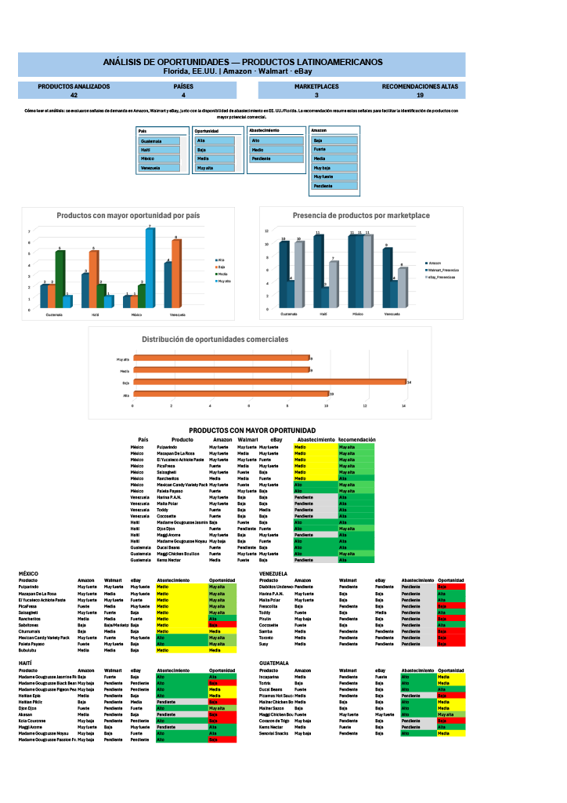

# Latin American Product Market Opportunity Analysis — Florida, USA

[🇪🇸 Versión en español](README.md) | 🇺🇸 English

## 📌 Project Overview

This project analyzes commercial opportunities for Latin American products targeting the Florida, USA market.

A total of **42 products from 4 countries** were evaluated:

- 🇲🇽 Mexico
- 🇻🇪 Venezuela
- 🇭🇹 Haiti
- 🇬🇹 Guatemala

The analysis combines commercial signals observed across:

- Amazon
- Walmart
- eBay

It also incorporates information related to competition, multichannel presence, and supplier availability in Florida and the United States.

The goal was to transform marketplace research into a structured dataset and interactive dashboards that help identify products with stronger commercial potential.

## 🎯 Analysis Objectives

The project aims to answer questions such as:

- Which products show stronger commercial signals?
- Which products are present across multiple marketplaces?
- How strong is the relative demand observed on Amazon?
- What commercial signals are visible on Walmart and eBay?
- Which products have sourcing options in Florida or the United States?
- Which products should receive higher commercial priority?

## 🛠️ Tools and Techniques

### Microsoft Excel

- Data cleaning and standardization
- XLOOKUP
- MINIFS
- IF, AND and OR formulas
- Dynamic array formulas
- FILTER
- SORTBY
- Excel Tables
- PivotTables
- PivotCharts
- Slicers
- Conditional formatting
- Interactive dashboards
- Executive reporting

## 📊 Analysis Workflow

The workflow followed in this project was:

**Marketplace Research**  
↓  
**Data Cleaning and Standardization**  
↓  
**Product-Level Summary**  
↓  
**Demand and Competition Classification**  
↓  
**Amazon, Walmart and eBay Analysis**  
↓  
**Supplier Research**  
↓  
**Multichannel Presence Evaluation**  
↓  
**Commercial Opportunity Classification**  
↓  
**Country-Level Dashboards**  
↓  
**Executive Dashboard**

## 📈 Executive Dashboard

The Executive Dashboard consolidates results from all four countries and includes:

- products analyzed;
- commercial opportunities by country;
- marketplace presence;
- opportunity distribution;
- interactive slicers;
- products with stronger commercial opportunity.

## 🌎 Country-Level Dashboards

The workbook also includes individual dashboards for:

- Mexico
- Venezuela
- Haiti
- Guatemala

These dashboards provide a deeper view of each market.

## 📂 Project Files

- `Analisis_Mercado_Productos_Latinoamericanos.xlsx` — main analysis workbook
- `README.md` — Spanish documentation
- `README_EN.md` — English documentation
- `images/` — dashboard screenshots

## ⚠️ Methodology Note

Demand and opportunity classifications are based on signals observed across Amazon, Walmart and eBay, together with sourcing information.

These signals **do not represent total sales for the Florida market**. They are comparative indicators used to evaluate products and prioritize commercial opportunities.

## 👩‍💻 About This Project

This project is part of my Data Analytics portfolio and was developed to practice a complete analysis workflow:

- data collection;
- data cleaning;
- data structuring;
- analysis;
- visualization;
- executive reporting.

The main objective is to demonstrate my ability to transform scattered data into clear and useful information that supports business decision-making.
